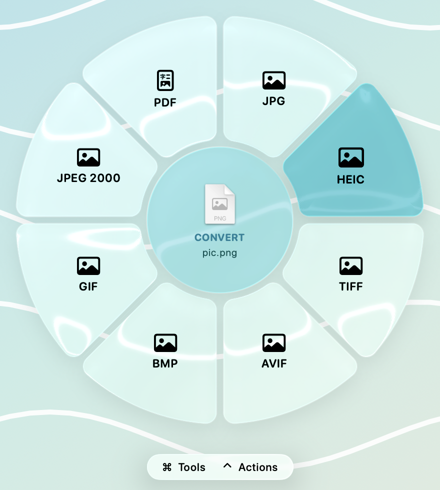
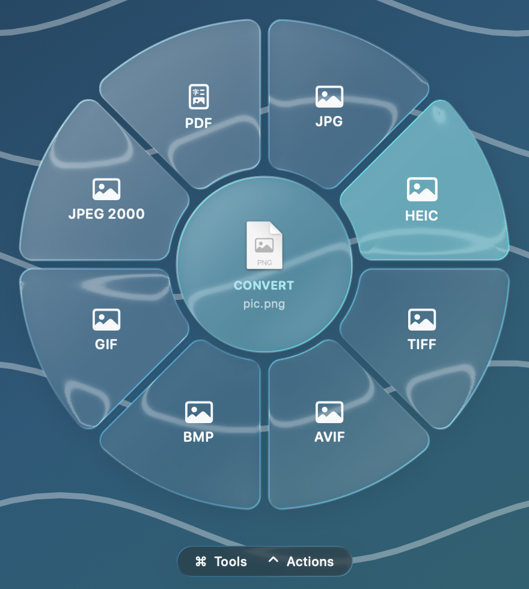

# Mer

**An offline file converter and toolbox for macOS, built around a Liquid Glass drag wheel.**
Drag a file, hold a key, drop it on a slice. Everything runs locally — nothing is uploaded.

> 一个 macOS 离线文件转换器：拖动文件、按住修饰键、放到转盘的某一格上即可转换。所有处理都在本机完成。

<p align="center">
  
  
</p>

Mer is an independent project. It is not affiliated with, or derived from the code of, any other converter app.

## Features

- **Drag wheel** — start dragging a file anywhere, hold <kbd>⇧</kbd> (convert), <kbd>⌘</kbd> (tools) or <kbd>⌃</kbd> (file actions). Keys are configurable. Hover **More** to page through long lists.
- **Command palette** — <kbd>⌥⌘T</kbd> on the Finder selection, or Finder → Services → *Convert with Mer*. Searchable, keyboard driven.
- **Command line** — `mer convert photo.heic --to jpg`, `mer run "Resize…" a.png --param size=800`, `mer list a.png`.
- **Liquid Glass UI** on macOS 26, with a frosted-material fallback on macOS 14–15.
- **English and 简体中文** — follows the system language by default; switch in Settings → General → Language (applies instantly).
- **Queue with progress**, output-folder policy, optional "move originals to Trash".

### What works with no extra software

46 conversions and 37 tools, built on system frameworks only:

| Area | Details |
|---|---|
| Images | JPG, PNG, HEIC, TIFF, AVIF, BMP, GIF, JPEG 2000, ICO, ICNS, PDF; SVG input; resize, rotate, flip, crop, compress, strip metadata |
| Audio / video | afconvert + AVFoundation: M4A, WAV, AIFF, FLAC; MP4, MOV, HEVC, GIF; trim, merge, mute, compress, frame grab |
| Documents | DOCX, ODT, RTF, HTML, TXT, PDF, **Markdown, EPUB** (native writers that keep headings, lists and hyperlinks) |
| PDF | to PNG/JPG/TXT/DOCX (text only), merge, split, extract pages, rotate, compress |
| **OCR** | Offline text recognition (Apple Vision) for images and scanned PDFs, including *searchable PDF* output |
| Data | CSV ⇄ TSV ⇄ JSON ⇄ XLSX |
| Other | SRT ⇄ VTT, ZIP / TAR / GZ / 7Z / RAR extraction, Pages / Keynote / Numbers conversion via the Apple apps if installed |

### Optional engines (auto-detected)

Install from **Settings → Engines** or `mer install <engine>` (uses Homebrew; nothing is bundled with Mer):

| Engine | Unlocks |
|---|---|
| FFmpeg | MKV, WebM, AVI, WMV, FLV, MP3, OGG, Opus, WMA, lossless trim, loudness normalise |
| Pandoc | Markdown / DOCX / EPUB / HTML / ODT / LaTeX / RST in every direction |
| ImageMagick | PSD, ICO, XCF, EPS/AI input and more |
| Ghostscript | Stronger PDF compression, vector EPS/AI → PDF |
| qpdf | PDF password protect / remove |
| LibreOffice | Office ⇄ PDF conversions (recipes included, **not yet tested**) |

Add your own with a **recipe**: drop a JSON file into `~/Library/Application Support/Mer/Recipes/` (Settings → Recipes has an example).

## Install

Download `Mer-<version>.dmg` from [Releases](../../releases), drag **Mer** to *Applications*.

The build is **ad-hoc signed and not notarized** (there is no Apple Developer ID behind it). If macOS says the app can't be opened, right-click it → *Open*, or run:

```bash
xattr -dr com.apple.quarantine /Applications/Mer.app
```

Requires macOS 14 or later on Apple silicon. The Liquid Glass look needs macOS 26.

## Build from source

```bash
git clone https://github.com/steinyanaa/mer.git && cd mer
./Scripts/bundle.sh        # → dist/Mer.app
./Scripts/make-dmg.sh      # → dist/Mer-<version>.dmg
```

Requires Xcode command-line tools (Swift 5.9+). Layout:

```
Sources/MerCore   engines, action registry, job queue (UI-free)
Sources/mer       command-line tool
Sources/MerApp    menu-bar app: wheel, palette, HUD, settings
```

### Tests

`./Scripts/regression.sh` generates its own fixtures and checks real outputs for every built-in engine (external engines are skipped when not installed), plus a check that every UI string has a Chinese translation. See [Scripts/README-testing.md](Scripts/README-testing.md).

## Known limitations

- Drag detection starts about 1–2 s after you begin dragging (Finder only publishes the file list once the drag really starts).
- PDF → DOCX keeps text only, not layout. Documents with images or tables should go through `textutil` paths (RTF/ODT/DOC → DOCX), which cannot preserve hyperlinks — a macOS limitation.
- The HUD and float cards get full-fidelity glass by overriding an undocumented `NSWindow` method (`hasMainAppearance`). If a future macOS removes it they fall back to frosted glass. This approach would not pass App Store review.
- Tested on macOS 26 only. The drag wheel was verified end to end on a real drag; the float-card drag-out and several external-engine recipes (LibreOffice, JPEG XL, XCF) are untested.
- A diagnostic log is written to `~/Library/Logs/Mer/drag.log` (menu bar → *Open Drag Log*). Settings → Wheel has a live **Key test** that shows whether Mer can see ⇧/⌘/⌃.
- Keep only one copy of Mer installed. Two copies share a bundle id, and macOS may then activate the other one instead of launching the one you opened.

## License

[MIT](LICENSE). Optional engines are separate programs with their own licenses (FFmpeg and Ghostscript are GPL/AGPL-licensed); Mer only runs them as external tools and never redistributes them.
